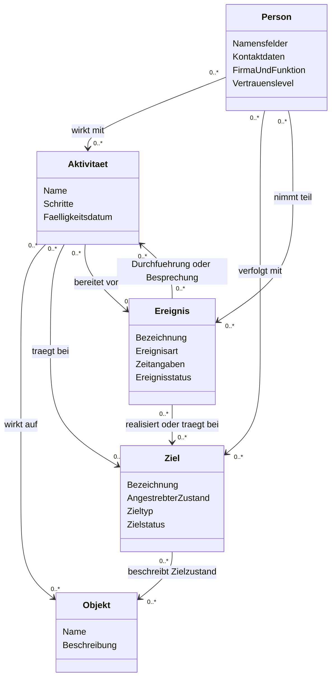

# Geschäftsentitätenmodell – Tätigkeitsstruktur

Version: V0R4  
Stand: 18. November 2026  
Status: Fachlicher Entwurf zur gemeinsamen Abstimmung

## 1. Zweck, Grundlage und Lesart

Dieses Modell definiert die fünf Geschäftsentitäten Objekt, Person, Aktivität, Ziel und Ereignis, ihre Attribute sowie die Beziehungen zwischen ihnen. Projekte und Themengebiete bilden die gemeinsame Kontextstruktur. Die Definition ist unabhängig von Datenbank, Programmiersprache und Bedienoberfläche.

Grundlage sind die gemeinsam beschriebenen Alltagssituationen A bis D und der aktuelle Konzeptentwurf „Taetigkeitsstruktur_Anwendungsfaelle_V0R1.md“, Stand 18. November 2026, gespeicherte Version 1.

**Festgelegt (F):** Aussagen, die Urs bereits beschrieben oder bestätigt hat.  
**Vorschlag (V):** Konkretisierungen dieses Modells, die noch gemeinsam abgestimmt werden können.

Festgelegt sind insbesondere:

- Die fünf getrennten, miteinander verknüpfbaren Geschäftsentitäten.
- Unternehmen und Funktion als Eigenschaften einer Person.
- Projekte als Kontexte und Filter; Themengebiete als deren Unterstruktur.
- Gegenstände und ihre Bestandteile als Objekte.
- Aktivitäten zur Beeinflussung von Zuständen von Objekten oder Personen sowie zur Vorbereitung von Ereignissen; jede Aktivität hat fachlich mindestens einen solchen Bezug.
- Höchstens eine verantwortliche Person je Aktivität und höchstens ein direktes Elternobjekt je Bestandteil.
- Objektfelder: Name und Beschreibung.
- Personenfelder entsprechend der iPhone-Kontaktstruktur, ergänzt um Vertrauenslevel von 0 bis 100.
- Aktivitätskern: Name, Schritte, Fälligkeitsdatum, Vorgänger/Vorbedingungen sowie Nachfolger/ist Vorbedingung.
- Die vorgeschlagenen Zielattribute einschließlich ihrer Ausprägungen sind bestätigt. Weitere zuvor vorgeschlagene Aktivitätsfelder bleiben bis zur Klärung ihres Umfangs als V gekennzeichnet.
- Aktivitäten dürfen erfasst werden, während ihre Zuordnung zu betroffenem Objekt, betroffener Person oder vorzubereitendem Ereignis noch fehlt. Ausschließlich diese fehlende Zuordnung kennzeichnet „Noch zuzuordnen“.
- Opportunities als Spezialisierung von Zielen in einer gemeinsamen Zielansicht.
- Aufgabenkommentare, optionale Gesprächsdokumentation, Tagessicht, Aufgabenabhängigkeiten, Prioritäten und Wiedervorlagen.
- E-Mail, WhatsApp, Telefon und Microsoft Teams als relevante Kommunikationskanäle; Telegram und Signal optional.
- Ereignisse können aus externen Kalendern übernommen werden; bekannte Personen sollen anhand vorhandener Informationen wie E-Mail-Adressen zugeordnet werden können.

Neu zur Diskussion stehen die gemeinsame Betrachtung als verknüpfbare Einträge beziehungsweise Tickets unterschiedlicher Dauerhaftigkeit und die präzisere Beziehung zwischen Ziel und Ereignisergebnis. Die entsprechende Ausgestaltung ist unten als V gekennzeichnet.

Alle folgenden konkreten Pflichtfelder, Auswahlwerte, Rollennamen, Kardinalitäten und Lebenszyklusregeln sind **Vorschläge**, soweit sie nicht ausdrücklich mit F gekennzeichnet sind. Das Modell macht diese Entscheidungen prüfbar; es stellt sie nicht als bereits beschlossene Anforderungen dar.

### Kardinalitäten

| Notation | Bedeutung |
|---|---|
| 1 | Genau ein Wert oder genau eine Verbindung |
| 0..1 | Optional, höchstens ein Wert oder eine Verbindung |
| 0..* | Keine, eine oder mehrere |
| 1..* | Mindestens eine |

Eine Beziehung wird als fachliche Aussage modelliert, etwa „Person führt Aktivität aus“. Sie kann eigene Informationen besitzen, etwa Rolle oder Rückmeldestatus. Dafür benötigte Zuordnungsdatensätze sind keine zusätzliche der fünf Geschäftsentitätsarten.

## 2. Gesamtbild

Die folgende Grafik zeigt die wichtigsten Beziehungen. Die vollständigen Beziehungen und Kardinalitäten stehen in Abschnitt 9.

Für Aktivitäten gilt fachlich immer: Sie beziehen sich auf mindestens ein betroffenes Objekt, eine betroffene Person oder ein vorzubereitendes Ereignis (F). Die einzelnen Beziehungen haben jeweils die Mindestzahl null, weil der Bezug über eine oder mehrere dieser Entitätsarten bestehen kann. Im erfassten Eintrag darf die konkrete Verknüpfung vorübergehend fehlen; genau dann gilt „Noch zuzuordnen“ (F). Das bezeichnet eine fehlende Information im Eintrag. Eine mitwirkende oder verantwortliche Person allein ersetzt den Bezug nicht. Ein bloßer Arbeitsblock ist ebenfalls noch kein vorzubereitendes Ereignis.

## 3. Gemeinsame Basiseigenschaften

Diese Eigenschaften gelten für alle fünf Entitäten. Ein abstrakter Oberbegriff dient hier nur dazu, gemeinsame Eigenschaften nicht fünfmal aufzuschreiben.

| Attribut | Fachlicher Typ | Anzahl | Bedeutung |
|---|---|---|---|
| Identität | Eindeutige Kennung | 1 | Bleibt bei Umbenennung und Änderungen erhalten; wird vom System vergeben |
| Name / Bezeichnung / Anzeigename | Text | 1 | Objekt und Aktivität: Name; Ziel und Ereignis: Bezeichnung/Titel; Person: aus Kontaktangaben abgeleiteter Anzeigename |
| Beschreibung / Notizen | Text | 0..1 | Objekt: Beschreibung; Person: Notizen der Kontaktkarte; Ziel/Ereignis: Beschreibung; bei Aktivitäten als zusätzliches Feld noch offen |
| Archiviert am | Zeitpunkt | 0..1 | Kennzeichnet einen archivierten Eintrag |
| Erstellt am / durch | Zeitpunkt / Urheber | Je 1 | Entstehung des Eintrags |
| Geändert am / durch | Zeitpunkt / Urheber | Je 1 | Letzte Änderung |

Erstellt/geändert durch kann ein Benutzer oder ein angebundener Dienst sein. Eine Person als Kontakt setzt kein Benutzerkonto voraus.

Projekt- und Themenzuordnungen, verantwortliche Personen, Kommentare und Quellen werden als Beziehungen beziehungsweise ergänzende Informationen geführt. Sie werden nicht als mehrfach kopierte Freitextfelder in den fünf Entitäten gespeichert.

Archivierung und fachlicher Status sind unabhängig: Eine erledigte Aktivität kann weiterhin in der laufenden Übersicht benötigt werden. Ein archivierter Eintrag behält seine Verbindungen und kann über die Historie gefunden werden.

### Gemeinsame Einträge beziehungsweise Tickets (V)

Die fünf Entitätsarten können als gemeinsame Familie verknüpfbarer Einträge betrachtet werden. Jeder Eintrag besitzt Identität, Typ, Basiseigenschaften, Kommentare und Beziehungen. Seine fachliche Bedeutung ergibt sich aus dem Typ.

| Eintragstyp | Typischer zeitlicher Charakter |
|---|---|
| Person | Dauerhafter Kontakt über viele Vorgänge und Projekte |
| Objekt | Länger bestehender Gegenstand mit fortlaufender Bearbeitung |
| Aktivität | Abgrenzbare Tätigkeit mit Bearbeitung und möglichem Abschluss |
| Ziel | Verfolgtes Ergebnis mit eigener Erfolgsbewertung |
| Ereignis | Zeitlich verankertes Geschehen oder vereinbarter Termin |

Die Dauerhaftigkeit ist eine typische Nutzung, keine feste Lebensdauer. Der gemeinsame Kern ermöglicht Suche, Kommentare und Verknüpfung über die Typen hinweg. Typbezogene Attribute und Lebenszyklen bleiben erhalten: Eine Person benötigt beispielsweise keinen Aufgabenabschluss.

„Ticket“ beschreibt hier das Bedien- und Ordnungsprinzip. Es ist kein zusätzlicher Arbeitsgegenstand, der parallel zu Person, Objekt oder Aufgabe gepflegt werden muss. Ob die Oberfläche den Begriff verwendet, bleibt offen.

## 4. Objekt

**Definition (F):** Ein materieller oder immaterieller Gegenstand, mit dem etwas gemacht werden kann und der zu managen ist. Beispiele sind Server, Software, Gartenhaus, Fenster und Elektrik.

### Fachliche Attribute (F)

| Attribut | Fachlicher Typ | Anzahl | Bedeutung |
|---|---|---|---|
| Name | Text | 1 | Benennung des Objekts |
| Beschreibung | Text | 0..1 | Frei formulierbare Informationen zum Objekt |

Das Objekt besitzt damit zwei fachliche Eingabefelder. Gemeinsame Verwaltungsinformationen, Kommentare, Projektzuordnungen und Beziehungen werden zusätzlich geführt.

### Beziehungen und Regeln

- Ein Objekt kann aus untergeordneten Objekten bestehen (F).
- Ein Bestandteil hat höchstens ein direkt übergeordnetes Objekt (F).
- Sachliche Beziehungen wie „läuft auf“ und „benötigt“ können mehrere Gegenstellen haben.
- Ein Objekt kann mit Personen, Aktivitäten, Zielen und Ereignissen verbunden sein.
- Gewünschte Zustände können in Zielen formuliert werden; die Tätigkeiten stehen in Aktivitäten.
- Die Objektübersicht kann Aktivitäten der Bestandteile einbeziehen und ihre Herkunft anzeigen.

## 5. Aktivität

**Definition (F):** Eine Tätigkeit beziehungsweise Aufgabe, mit der ein Zustand eines Objekts oder einer Person verändert oder ein Ereignis vorbereitet werden soll. Zustände zu erhalten oder zu klären wird als ergänzender Vorschlag mit berücksichtigt.

Beispiele: „Elektrik einbauen“, „Anforderungen mit Anna klären“, „Interessenten anrufen“, „Agenda für den Termin vorbereiten“.

### Bestätigte Felder und Zuordnungen (F)

| Feld | Fachlicher Typ | Anzahl | Bedeutung |
|---|---|---|---|
| Name | Text | 1 | Name der Aktivität |
| Schritte | Geordnete Liste | 0..* | Zur Aktivität gehörende Schritte |
| Fälligkeitsdatum | Datum | 0..1 | Bis zu welchem Tag die Aktivität erledigt sein soll |
| Vorgänger / Vorbedingungen | Beziehung zu Aktivitäten | 0..* | Aktivitäten, deren Abschluss Voraussetzung ist |
| Nachfolger / ist Vorbedingung | Inverse Sicht auf dieselbe Beziehung | 0..* | Aktivitäten, für die diese Aktivität Voraussetzung ist |

Vorgänger und Nachfolger sind zwei Blickrichtungen auf R08. Wird Aktivität A als Vorgänger von B gesetzt, erscheint B automatisch als Nachfolger von A. Die Verbindung wird einmal gepflegt.

Die genannten Vorbedingungen werden zunächst als Vorgängeraktivitäten geführt. Ob zusätzlich freie oder andere Arten von Bedingungen benötigt werden, bleibt offen.

### Ausgestaltung der Schritte (V)

Ein Schritt kann als Listenpunkt mit Reihenfolge und Text geführt werden. Eine zusätzliche Abhakmöglichkeit wird vorgeschlagen. Ein Schritt gehört zu genau einer Aktivität und erhält zunächst keine eigene Fälligkeit oder eigenständigen Abhängigkeiten. Eine Tätigkeit mit eigener Planung kann als separate Aktivität verknüpft werden.

### Zuvor vorgeschlagene zusätzliche Aktivitätsangaben – Umfang offen (V)

Bearbeitungsstatus, Priorität, Wiedervorlage, Bearbeitungstag, geschätzter Aufwand, Aktivitätsart, Kommunikationsweg und ein gesondertes Ergebnisfeld wurden zuvor vorgeschlagen. Die aktuelle Rückmeldung bestätigt den oben genannten Kern; sie entscheidet noch nicht ausdrücklich über die übrigen Angaben. Sie werden deshalb als offene Vorschläge geführt.

Kanban, Tagesplanung, das Erkennen abgeschlossener Vorgänger und die Vertriebswiedervorlage benötigen entsprechende Prozessinformationen. Welche davon als sichtbare Aktivitätsfelder vorgesehen werden, wird gezielt geklärt. Es erfolgt keine stillschweigende Streichung der bereits beschriebenen Anwendungsfälle.

Konkrete Arbeitszeiten werden weiterhin über Ereignisse verbunden. Eine Aktivität kann mehrere Arbeitsblöcke besitzen.

### Bezug, Mitwirkung und Rückmeldung

Eine Aktivität unterscheidet mindestens diese Verbindungen:

| Verbindung | Bedeutung | Beispiel |
|---|---|---|
| Betroffenes Objekt | Gegenstand, dessen Zustand beeinflusst werden soll | Elektrik des Gartenhauses |
| Betroffene Person | Person, deren Kenntnisstand, Entscheidung oder Vereinbarung betroffen ist | Interessentin, mit der ein Angebot zu klären ist |
| Vorzubereitendes Ereignis | Ereignis, für das die Aktivität eine Vorbereitung leistet | Termin, für den eine Agenda entsteht |
| Verantwortliche Person | Hält die Aktivität insgesamt nach | Urs |
| Ausführende Person | Führt die Tätigkeit aus | Elektriker |
| Weitere beteiligte Person | Wirkt mit oder ist einzubeziehen | Weitere Ansprechpartnerin |
| Erwartete Rückmeldung | Antwort oder Beitrag einer konkreten Person steht aus | Preisbestätigung vom Elektriker |

**Festgelegt (F):** Jede Aktivität bezieht sich fachlich auf mindestens ein betroffenes Objekt, eine betroffene Person oder ein vorzubereitendes Ereignis.

**Festgelegt (F):** „Noch zuzuordnen“ bedeutet ausschließlich, dass im erfassten Aktivitätseintrag die Verbindung zu betroffenem Objekt, betroffener Person oder vorzubereitendem Ereignis noch fehlt. Der Eintrag ist bereits eine Aktivität. Er kann bereits Name, Schritte, Fälligkeitsdatum, Kommentare und weitere vorhandene Verbindungen besitzen.

Der Hinweis wird aus dem gemeinsamen Fehlen von R03, R04 und R17 ermittelt. Ein fehlendes Projekt, eine fehlende Priorität oder eine noch nicht benannte verantwortliche Person lösen ihn nicht aus. Das Ergänzen der ersten entsprechenden Objekt-, Personen- oder Vorbereitungsverbindung beseitigt den Hinweis; weitere Bezüge können ergänzt werden.

Vorschlag für die Bedienung: Eine vorhandene Aktivität kann nachträglich zugeordnet werden, ohne sie neu anzulegen oder ihren Bearbeitungsstatus ändern zu müssen. Das Entfernen der letzten fachlichen Verbindung über R03, R04 oder R17 führt wieder zum Zuordnungshinweis. Es wird kein Ersatzobjekt und keine künstliche Person angelegt.

Eine eigene Zieleintragung ist für eine Aktivität optional. Ihr beabsichtigtes Ergebnis kann im Namen oder in den Schritten erkennbar sein; ein zusätzliches Ergebnisfeld bleibt ein offener Vorschlag.

### Ereignisvorbereitung und Arbeitszeit

R17 „Aktivität bereitet Ereignis vor“ beschreibt einen fachlichen Bezug. Dafür ist kein zusätzlicher Objekt- oder Personenbezug erforderlich. R13 beschreibt dagegen, in welchem Ereignis eine Aktivität durchgeführt oder besprochen wird.

Beispiel: Die Aktivität „Agenda vorbereiten“ bereitet die Besprechung am Mittwoch vor (R17). Für ihre Bearbeitung kann ein Arbeitsblock am Dienstag bestehen (R13). Ein reiner Arbeitsblock erfüllt für sich allein die fachliche Zuordnung nicht.

### Erwartete Rückmeldung als qualifizierte Verbindung

| Information | Fachlicher Typ | Anzahl |
|---|---|---|
| Zugehörige Aktivität | Verweis auf Aktivität | 1 |
| Person, von der die Rückmeldung erwartet wird | Verweis auf Person | 1 |
| Erwarteter Inhalt | Text | 1 |
| Angefragt am | Datum oder Zeitpunkt | 0..1 |
| Rückmeldung erwartet bis | Datum oder Zeitpunkt | 0..1 |
| Rückmeldestatus | Offen, beantwortet, entfallen | 1 |
| Beantwortet am | Datum oder Zeitpunkt | 0..1 |
| Zugehöriger Kommentar oder Kommunikationsbeleg | Verweis | 0..* |

Mehrere Rückmeldungen können zu derselben Aktivität gehören. Die Personenansicht kann deshalb sowohl die Zahl offener Rückmeldungen als auch die Zahl verschiedener betroffener Aufgaben zeigen.

„Wartet auf Rückmeldung“ und „durch Vorgänger blockiert“ sind zusätzliche Merkmale. Sie können mit einem Bearbeitungsstatus kombiniert werden, soweit dieser vorgesehen wird: Eine Aktivität kann beispielsweise in Arbeit sein und zugleich eine Rückmeldung erwarten.

Eine Wiedervorlage kann auf eine erwartete Rückmeldung hinweisen. Die Wiedervorlage der Aktivität und die erwartete Antwortfrist der Rückmeldung sind unterschiedliche Angaben.

## 6. Person

**Definition (F):** Ein Mensch mit Kontaktangaben und den Verbindungen zu den übrigen Entitäten. Der Kontaktaufbau entspricht den iPhone-Kontakten. Hinzu kommt das eigene Feld Vertrauenslevel.

### Kontaktfelder nach dem iPhone-Aufbau (F: Orientierung und Umfang; V: konkrete Pflichtregeln)

| Feldgruppe | Inhalt | Anzahl |
|---|---|---|
| Name | Vorname, zweiter Vorname, Nachname | Je 0..1 |
| Namenszusätze | Präfix, Suffix, früherer Nachname, Spitzname | Je 0..1 |
| Lautschrift / Aussprache | Zusätzliche Namensangaben | Optional |
| Beruf | Firma, Abteilung, Position/Funktion | Je 0..1 |
| Telefonnummern | Nummer und Beschriftung | 0..* |
| E-Mail-Adressen | Adresse und Beschriftung | 0..* |
| Anschriften | Straße, PLZ, Ort, Region, Land; Beschriftung | 0..* |
| Websites | URL und Beschriftung | 0..* |
| Geburtstag | Kalenderdatum | 0..1 |
| Weitere Daten | Datum und Beschriftung | 0..* |
| Profile / Chatadressen | Dienst, Kennung und Beschriftung | 0..* |
| Zugehörige Namen / Beziehungen | Name und Beziehung | 0..* |
| Kontaktfoto | Bild | 0..1 |
| Notizen | Text | 0..1 |
| Pronomen | Sprachbezogene Formen | Optional |

Mehrfachfelder behalten ihre Beschriftungen, etwa privat, Arbeit, mobil oder eine eigene Bezeichnung. Der angezeigte Name wird aus den Kontaktangaben abgeleitet; er muss nicht zusätzlich zu den Namensfeldern gepflegt werden. Vorschlag: Für die Erfassung genügt eine identifizierende Namens- oder Kontaktangabe.

Die Berufsfelder folgen dem Kontaktkartenaufbau. Ein zusätzliches Mehrfachmodell für Firmenzugehörigkeiten mit Zeiträumen wird damit nicht als eigenes Personenfeld vorgesehen.

Quellen für den Kontaktaufbau:
- [Apple: CNContact](https://developer.apple.com/documentation/contacts/cncontact)
- [Apple: Kontakte auf dem iPhone bearbeiten](https://support.apple.com/en-lamr/guide/iphone/iph89a9c71d8/27/ios/27)
- [Apple: Kontaktinformationen einschließlich Pronomen](https://support.apple.com/guide/iphone/add-your-contact-info-iph18b749db1/27/ios/27)

Diese Festlegung beschreibt die Datenfelder und die Kontaktkartenstruktur. Der konkrete Austausch einzelner Felder sowie iPhone-spezifische Darstellungs- und Geräteeinstellungen werden beim Integrationsentwurf geprüft.

### Ergänzung: Vertrauenslevel

| Eigenschaft | Festlegung |
|---|---|
| Attribut | Vertrauenslevel |
| Wertebereich (F) | 0 bis 100 einschließlich |
| Konkreter Zahlentyp (V) | Ganze Zahl |
| Pflicht (V) | Optional |
| Vorbelegung (V) | Nicht bewertet; kein voreingestellter Zahlenwert |
| Pflege (V) | Manuelle Eingabe |

„Nicht bewertet“ und der Wert 0 sind unterschiedliche Angaben. Das Vertrauenslevel wird als eigene Ergänzung zur Kontaktkarte geführt.

### Beziehungen und Regeln

- Eine Person bleibt über Projekte, Kalender und Kommunikationskanäle hinweg derselbe Kontakt.
- Mehrere Quellkontakte können mit derselben Person verbunden sein.
- Unternehmen ist ein Kontaktattribut (F).
- Aufgabenrollen und Zielrollen stehen an den jeweiligen Verbindungen.
- Zugehörige Namen aus der Kontaktkarte können bei eindeutiger Identität mit vorhandenen Personen verbunden werden; ein bloßer Name erzeugt noch keine automatische Identitätsgleichheit.
- Eine verantwortliche Person kann zugleich ausführend sein; die Rollen bleiben getrennt.

## 7. Ziel und Spezialisierung Opportunity

**Bestätigt (F):** Die vorgeschlagenen Attribute und Ausprägungen für Ziele einschließlich Opportunities sind angenommen. Weitergehende Regeln zur Ergebnisbewertung und zu automatischen Statusableitungen bleiben als V gekennzeichnet, soweit nicht gesondert bestätigt.

**Definition (F):** Ein gewünschter Zustand, dessen Erreichung über Aktivitäten, Personen, Objekte und Ereignisse verfolgt werden kann.

**Erweiterung zur Diskussion (V):** Ein Ziel kann außerdem als gewünschter Eintritt eines Ereignisses mit einem bestimmten Ergebnis formuliert werden. Der Zielinhalt beschreibt dann, welches Geschehen mit welchem Ausgang eintreten soll. Ein später geplantes oder dokumentiertes Ereignis kann diesen Wunsch realisieren.

### Bestätigte Attribute und Ausprägungen (F)

| Attribut | Fachlicher Typ | Anzahl | Bedeutung |
|---|---|---|---|
| Zieltyp | Auswahl | 1 | Allgemeines Ziel oder Opportunity; später erweiterbar |
| Angestrebter Zustand oder Ereignisergebnis | Text | 1 | Inhaltlicher Zielzustand beziehungsweise gefordertes Geschehen mit Ergebnis; kann zunächst durch den Titel beschrieben sein |
| Erfolgskriterien | Beschreibungen | 0..* | Woran die Erreichung beurteilt wird |
| Zielstatus | Auswahl | 1 | Offen, in Verfolgung, pausiert, erreicht oder beendet ohne Erreichung |
| Zieltermin | Datum oder Zeitpunkt | 0..1 | Optionaler Termin für den Zielzustand |
| Priorität | Auswahl | 0..1 | Hoch, normal, niedrig |
| Messgrößen | Strukturierte Werte | 0..* | Optional: Name, Istwert, Sollwert, Einheit und Bewertungszeitpunkt |
| Beurteilung / Ergebnis | Text | 0..1 | Einordnung des Fortschritts oder Abschlusses |
| Erreicht / beendet am | Datum oder Zeitpunkt | 0..1 | Zeitpunkt der Ergebnisfeststellung |

Die Messgrößen ergänzen qualitative Erfolgskriterien. Die Erreichung wird nicht allein aus der Anzahl erledigter Aufgaben abgeleitet.

### Ziel und Ereignis mit bestimmtem Ergebnis (V)

| Ziel | Zugehöriges Ereignis | Gefordertes Ergebnis |
|---|---|---|
| Ein Academy-Workshop wurde mit mindestens zwölf zahlenden Teilnehmenden durchgeführt | Der konkrete Workshoptermin | Durchführung und mindestens zwölf zahlende Teilnehmende |
| Ein Auftrag ist verbindlich zustande gekommen | Die Vertragsunterzeichnung | Vertrag mit dem vorgesehenen Inhalt geschlossen |
| Die Elektrik des Gartenhauses funktioniert | Einbau- beziehungsweise Prüftermin | Gewünschte Funktion festgestellt |

Das Ziel beschreibt die erwartete Erfüllung, das Ereignis das konkrete geplante oder tatsächliche Geschehen. Ein Ereignis kann stattgefunden haben, während das geforderte Ergebnis verfehlt wurde.

R15 wird deshalb als qualifizierte direkte Verbindung geführt:

- **Beitrag:** Das Ereignis hilft, ein Ziel zu erreichen, etwa ein Vorbereitungsgespräch.
- **Realisierung:** Das Ereignis soll oder kann das Ziel unmittelbar erfüllen.
- **Prüfung:** Im Ereignis wird festgestellt, ob der gewünschte Zustand erreicht wurde.

Das geforderte Ergebnis steht beim Ziel beziehungsweise seinen Erfolgskriterien. Das tatsächliche Ergebnis und gegebenenfalls Messwerte stehen beim Ereignis. Die Beziehung bezeichnet die Rolle des Ereignisses und kann seine konkrete Ergebnisbewertung erläutern.

Die Verknüpfung als Realisierung allein setzt den Zielstatus nicht auf „erreicht“. Die Ergebnisbewertung vergleicht den geforderten Ausgang mit dem tatsächlichen Ergebnis. Auch mehrere Ereignisse können zusammen für ein Ziel erforderlich sein; das wird in den Erfolgskriterien beschrieben.

Ein Ereignis mit noch unbekanntem Termin kann zunächst als gewünschter Erfüllungsfall im Ziel beschrieben sein. Ein zusätzlicher Kalendereintrag ist erst sinnvoll, wenn ein konkretes Geschehen geplant oder dokumentiert wird.

Ziele können zunächst ohne verknüpftes Objekt oder Person formuliert werden. Die fachlichen Verbindungen werden nach Bedarf ergänzt. Ein Ziel muss nicht eigens einen künstlichen Gegenstand erzeugen, nur um gespeichert werden zu können.

### Opportunity als Spezialisierung

**Festgelegt (F):** Eine Opportunity ist ein Ziel mit zusätzlichen Vertriebseigenschaften. Sie behält dieselbe Identität, Zielbeziehungen und Zielansicht.

| Zusätzliches Attribut | Fachlicher Typ | Anzahl | Bedeutung |
|---|---|---|---|
| Angebotene Leistung | Text oder Objektbezug | 0..1 | Leistung beziehungsweise Angebot, um das es geht |
| Vertriebsphase | Auswahl | 0..1 | Vorschlag: identifiziert, Qualifizierung, Angebot, Verhandlung |
| Erwarteter Auftragswert | Geldbetrag mit Währung | 0..1 | Optionaler Prognosewert |
| Erwartete Entscheidung | Datum | 0..1 | Erwarteter Zeitpunkt der Kaufentscheidung |

Personen werden über Ziel-Person-Beziehungen mit Rollen wie Ansprechpartner, Entscheider, Mitwirkender oder Begünstigter verbunden.

**Vorschlag zur Konsistenz:** Der Zielstatus bestimmt das Vertriebsergebnis: „erreicht“ entspricht „gewonnen“, „beendet ohne Erreichung“ einem Abschluss ohne Erfolg und „pausiert“ einer zurückgestellten Opportunity. Die Vertriebsphase beschreibt den laufenden Verkaufsprozess. Ein zweites, unabhängig gepflegtes Abschlussstatusfeld ist damit nicht erforderlich.

Das Datum „erwartete Entscheidung“ ist eine Prognose; der Zieltermin kann eine eigene gewünschte Frist ausdrücken.

Die Zielansicht kann nach Zieltyp, Projekt, Person, Status oder Vertriebsphase filtern. Eine Opportunity erscheint damit als Spezialisierung in derselben Sicht wie die übrigen Ziele.

## 8. Ereignis

**Definition (F):** Ein geplanter oder dokumentierter Kalendereintrag, der mit den übrigen Entitäten verbunden werden kann.

Beispiele: gemeinsamer Termin, vereinbartes Telefonat, Arbeitsblock, kurz dokumentierter Anruf.

### Attribute zusätzlich zu den Basiseigenschaften

| Attribut | Fachlicher Typ | Anzahl | Bedeutung |
|---|---|---|---|
| Ereignisart | Auswahl | 0..1 | Besprechung, Telefonat, Arbeitsblock, Seminar/Workshop oder sonstiges |
| Ereignisstatus | Auswahl | 1 | Geplant, stattgefunden oder abgesagt |
| Geplanter Beginn / Ende | Datum oder Zeitpunkt | Je 0..1 | Vereinbarter beziehungsweise vorgesehener Zeitraum |
| Tatsächlicher Beginn / Ende | Datum oder Zeitpunkt | Je 0..1 | Soweit bekannt dokumentierter tatsächlicher Zeitraum |
| Ganztägig | Ja/Nein | 1 | Termin ohne konkrete Uhrzeiten |
| Zeitzone | Zeitzonenangabe | 0..1 | Bei Ereignissen mit Uhrzeit erforderlich |
| Ort | Text | 0..1 | Physischer Ort |
| Kommunikationsweg / Zugangsverweis | Kanal und optional Verweis | 0..1 | Teams-Link, Telefonnummer oder anderer Zugang |
| Ergebnis / Gesprächsnotiz | Text | 0..1 | Optionale Dokumentation des tatsächlichen Ausgangs |
| Ergebniswerte | Strukturierte Werte | 0..* | Optional: Messgröße, Wert und Einheit, etwa Zahl zahlender Teilnehmender |

### Regeln

- Ein geplantes Ereignis benötigt mindestens einen geplanten Beginn. Ein dokumentiertes stattgefundenes Ereignis benötigt mindestens einen tatsächlichen Beginn; eine bloße Datumsangabe ist zulässig.
- Eine unbekannte Endzeit kann fehlen. Vorhandene Endangaben dürfen nicht vor den zugehörigen Beginnangaben liegen.
- Ganztägige Ereignisse verwenden Datumsangaben; ein fehlendes Ende steht für einen einzelnen Tag.
- Bei zeitgenauen Ereignissen ist die Zeitzone Teil der fachlichen Zeitinformation.
- Ein geplantes und später dokumentiertes Ereignis behält dieselbe Identität. Plan- und Istangaben können gemeinsam erhalten bleiben.
- Der Ablauf der geplanten Zeit allein bestätigt nicht, dass das Ereignis stattgefunden hat.
- Ein Ereignis kann mehrere Aktivitäten zum Gegenstand haben. Ein Telefonat kann etwa zwei Aufgaben besprechen.
- Ein Ereignis braucht keine zugehörige Aktivität. Ein bereits vorhandener Kalendertermin kann selbstständig eingebunden werden.
- Eine Aufgabe auf Wiedervorlage braucht kein Ereignis.
- Das optionale Dokumentieren eines Anrufs und das Kommentieren von Aufgaben sind unabhängig möglich.

### Entstehung aus einem externen Kalender

**Festgelegt (F):** Ein Ereignis kann außerhalb des Programms angelegt und anschließend aus einem Kalender übernommen werden. Vorhandene Teilnehmer- oder Organisatoradressen können zur Zuordnung zu Personen genutzt werden.

Die fachlichen Regeln für die vorgeschlagene Zuordnung sind in Abschnitt 11 beschrieben. Herkunft und externe Identität bleiben dabei erhalten; ein importiertes Ereignis ist derselbe fachliche Ereignistyp wie ein hier angelegter Termin.

## 9. Beziehungskatalog

Kardinalitäten in diesem Katalog sind Vorschläge, soweit sie nicht als F gekennzeichnet sind. Festgelegt sind insbesondere das eine direkte Elternobjekt als Obergrenze, die Obergrenze einer verantwortlichen Person je Aktivität und der fachlich notwendige Bezug von Aktivitäten zu betroffenem Objekt, betroffener Person oder vorzubereitendem Ereignis. „Beidseits 0..*“ bedeutet: Jede Seite kann mit keinem, einem oder mehreren Einträgen der anderen Seite verbunden sein.

### 9.1 Objekte, Personen und Aktivitäten

| ID | Fachliche Beziehung | Kardinalität | Zusätzliche Information / Regel |
|---|---|---|---|
| R01 | Objekt ist Bestandteil von Objekt | Je Bestandteil 0..1 Elternobjekt (F); je Elternobjekt 0..* Bestandteile | Gerichtete Struktur; Kreisfreiheit als V |
| R02 | Objekt läuft auf / benötigt Objekt | Beidseits 0..* | Beziehungstyp; getrennt von R01 |
| R03 | Aktivität wirkt auf Objekt | Beidseits 0..* | Betroffener Gegenstand |
| R04 | Aktivität wirkt auf Person | Beidseits 0..* | Betroffene Person; nicht automatisch ausführende Person |
| R05 | Person wirkt an Aktivität mit | Beidseits 0..* | Rolle: verantwortlich, ausführend oder beteiligt |
| R06 | Zu Aktivität wird Rückmeldung von Person erwartet | Je Aktivität 0..* Erwartungen; je Person 0..* Erwartungen | Jede einzelne Erwartung gehört genau einer Aktivität und einer Person; Status und Inhalt gemäß Abschnitt 5 |
| R07 | Person verantwortet / betreut Objekt | Beidseits 0..* | Rolle, optional Beschreibung |
| R08 | Aktivität ist zwingender Vorgänger von Aktivität | Je Aktivität 0..* Vorgänger und 0..* Nachfolger | Gerichtete, kreisfreie Abhängigkeit |

Für R03, R04 und R17 gilt gemeinsam (F): Jede Aktivität hat fachlich mindestens ein betroffenes Objekt, eine betroffene Person oder ein vorzubereitendes Ereignis. Solange jede dieser konkreten Verbindungen im Eintrag fehlt, gilt „Noch zuzuordnen“. Die einzelnen Beziehungen haben jeweils die Mindestzahl null, weil die Mindestanforderung alternativ über eine der drei Beziehungen erfüllt werden kann.

Für die verantwortliche Rolle in R05 gilt höchstens eine Person je Aktivität (F). Mehrere ausführende oder beteiligte Personen sind möglich. Eine Person kann zugleich mehrere Rollen innehaben.

R01 beschreibt Teile desselben Gegenstands. R02 beschreibt technische oder sachliche Beziehungen zwischen eigenständigen Gegenständen. Die Kreisfreiheit von R01 wird nicht pauschal auf alle anderen Objektbeziehungen übertragen.

### 9.2 Ziele und Ereignisse

| ID | Fachliche Beziehung | Kardinalität | Zusätzliche Information / Regel |
|---|---|---|---|
| R09 | Ziel beschreibt gewünschten Zustand für Objekt | Beidseits 0..* | Optional objektspezifische Erläuterung |
| R10 | Person steht mit Ziel in Verbindung | Beidseits 0..* | Rolle: gemeinsam verfolgend, verantwortlich, betroffen, Ansprechpartner, Entscheider oder begünstigt |
| R11 | Aktivität trägt zu Ziel bei | Beidseits 0..* | Optional Beschreibung des Beitrags |
| R12 | Person nimmt an Ereignis teil | Beidseits 0..* | Rolle, optional Teilnahmeantwort |
| R13 | Ereignis dient Aktivität | Beidseits 0..* | Rolle: Durchführung oder Besprechung |
| R14 | Ereignis bezieht sich auf Objekt | Beidseits 0..* | Direkter Gegenstandsbezug |
| R15 | Ereignis trägt zu Ziel bei, realisiert es oder prüft es | Beidseits 0..* | Direkter Zielbezug; Beziehungstyp und optionale Ergebnisbewertung (V) |
| R16 | Ziel unterstützt übergeordnetes Ziel | Je Ziel 0..* über- und untergeordnete Ziele | Optionale Ergänzung; gerichtete, kreisfreie Unterstützungsstruktur |
| R17 | Aktivität bereitet Ereignis vor | Beidseits 0..* | Fachlicher Bezug zur Ereignisvorbereitung (F); getrennt von R13 |

R10 unterscheidet insbesondere eine betroffene Person von einer mitwirkenden oder entscheidenden Person. Dieselbe Person kann mehrere Rollen bei einem Ziel haben.

R16 ist ein Vorschlag für die spätere Zielgliederung, keine bereits aus den Beispielen zwingend erforderliche Funktion. Ein Ziel kann mehrere andere Ziele unterstützen; es wird dadurch nicht kopiert.

### 9.3 Direkte und abgeleitete Beziehungen

Gemeinsame Projektzugehörigkeit bedeutet nicht automatisch eine direkte Beziehung.

Beispiel: Dass eine Person und eine Aufgabe zum Projekt Gartenhaus gehören, macht die Person nicht zur ausführenden oder rückmeldungspflichtigen Person dieser Aufgabe.

Indirekte Zusammenhänge können in Sichten angezeigt werden. Beispielsweise lässt sich ein Ziel über eine gemeinsame Aufgabe finden. Dabei bleibt erkennbar, dass es sich um einen indirekten Treffer handelt. Eine beliebig lange Verknüpfungskette macht nicht jede Person für jeden Eintrag zuständig.

## 10. Projekte und Themengebiete

**Festgelegt (F):** Projekte und Themengebiete dienen der Einordnung und Filterung der fünf Entitäten. Themengebiete liegen innerhalb eines Projekts.

### Verwaltungsinformationen

| Ordnungsmerkmal | Vorgeschlagene Eigenschaften |
|---|---|
| Projekt | Kennung, Bezeichnung, Beschreibung, optional Bezug zur Unternehmung als Text, Archivierung |
| Themengebiet | Kennung, Bezeichnung, Beschreibung, Projektzugehörigkeit, optional übergeordnetes Themengebiet, Archivierung |

### Zuordnungsregeln

| Verbindung | Kardinalität / Regel |
|---|---|
| Entität zu Projekt | Je Entität 0..* Projekte; je Projekt 0..* Entitäten |
| Themengebiet zu Projekt | Jedes Themengebiet gehört genau zu einem Projekt; jedes Projekt hat 0..* Themengebiete |
| Entität zu Themengebiet | Je Entität 0..* Themengebiete; je Themengebiet 0..* Entitäten |
| Themengebiet zu übergeordnetem Themengebiet | 0..1 Elterngebiet; 0..* Untergebiete; gleiches Projekt; kreisfrei |

Die Zuordnung zu einem Themengebiet schließt die Zugehörigkeit zu dessen Projekt ein. Die Benutzeroberfläche verlangt dafür keine doppelte Pflege.

Ein Eintrag kann mehreren Projekten und Themengebieten zugeordnet sein und behält dieselbe Identität. Einträge ohne Zuordnung bleiben zulässig.

Ein Projekt „Gartenhaus“ und ein Objekt „Gartenhaus“ haben unterschiedliche Aufgaben: Das Projekt ist der Filterkontext; das Objekt besitzt Name, Beschreibung und Verbindungen zu Bestandteilen. Das Projekt kann dieses Objekt und weitere Entitäten umfassen.

Die Verknüpfung zweier Entitäten kopiert deren Projektzuordnungen nicht automatisch. Sonst würden beispielsweise alle Kontakte eines Partners schrittweise in alle Projekte gelangen. Projektbezogene Sichten können mittelbar beteiligte Personen zusätzlich anzeigen und den Bezug kenntlich machen.

## 11. Ergänzende Informationen und Anbindungen

Diese Bausteine ermöglichen die fünf Entitäten und ihre Beziehungen. Sie bekommen keine eigene gleichrangige Hauptsicht.

| Baustein | Wesentliche Informationen | Verbindung |
|---|---|---|
| Kommentar | Inhalt, Autor, Zeitpunkt, optional Herkunft | Jeder Kommentar gehört zu genau einer Entität; jede Entität hat 0..* Kommentare |
| Dokument / Quellenbeleg | Titel, Verweis, optional Datei oder Textauszug | Ein Beleg kann mit 0..* Entitäten verbunden sein; vor vollständiger Zuordnung erfassbar |
| Kommunikationsbeleg | Kanal, Datum oder Zeitpunkt, Beteiligte beziehungsweise Absender/Empfänger, Inhalt oder Verweis | Kann mehrere Entitäten erläutern, etwa ein Telefonat und zwei Aufgaben |
| Externe Zuordnung | Quellsystem, Konto, externe Kennung, optional Termininstanz und Synchronisationsstand | Ordnet externe Kontakte und Ereignisse den fachlichen Einträgen zu |

### Kommentare und Ereignisse

Wird dasselbe Telefonat als Ereignis dokumentiert und in zwei Aufgaben besprochen, entsteht ein Ereignis mit zwei Aktivitätsverbindungen und gegebenenfalls zwei unterschiedlichen Aufgabenkommentaren. Diese Kommentare können auf das Ereignis verweisen.

Ein Kommentar an einer Aufgabe dokumentiert eine Information. Ob damit eine erwartete Rückmeldung beantwortet oder die Aktivität erledigt ist, wird separat kenntlich gemacht.

### Kommunikationskanäle

| Vorgesehen | Optional |
|---|---|
| E-Mail, WhatsApp, Telefon, Microsoft Teams | Telegram, Signal |

Die Kanäle sind fachlich berücksichtigt (F). Umfang und technische Machbarkeit ihrer Anbindung sind noch zu prüfen. Das Modell setzt keine automatische Vollübernahme oder automatische Anruferkennung voraus.

Kommunikationsbelege können mit bestehenden Entitäten verknüpft werden. Aus einer Nachricht kann eine Aktivität entstehen, deren Quelle erhalten bleibt.

Externe Zuordnungen verhindern, dass wiederholtes Einlesen eines bekannten Kontakts oder Termins einen zweiten fachlichen Eintrag erzeugt. Quellsystem, Konto und externe Kennung werden gemeinsam betrachtet; bei wiederkehrenden Terminen kann zusätzlich die Termininstanz nötig sein.

Ein externer Kontakt kann derselben Person wie weitere Kontakte aus anderen Quellen zugeordnet werden. Die Erkennung über eine bekannte Adresse kann Zuordnungen unterstützen. Die konkrete Behandlung eindeutiger und mehrdeutiger Treffer wird nachfolgend vorgeschlagen.

### Zuordnung importierter Kalenderereignisse (F: Anforderung; V: konkrete Regeln)

1. Das Ereignis wird zuerst über seine externe Zuordnung erkannt. Ein wiederholter Import aktualisiert den bekannten Eintrag.
2. Vorhandene Zuordnungen externer Kontakte werden genutzt. Teilnehmer- und Organisatoradressen können zusätzlich mit den Kontaktdaten vorhandener Personen abgeglichen werden.
3. Ein eindeutiger Treffer auf eine bereits bekannte Adresse kann die betreffende Person automatisch als Teilnehmer beziehungsweise Organisator verbinden. Herkunft und Rolle der Verbindung bleiben nachvollziehbar.
4. Bei mehreren passenden Personen bleibt die Zuordnung offen und die Auswahl kann gezielt ergänzt werden. Bei einer unbekannten Adresse bleiben die importierten Angaben erhalten; daraus kann später ein Kontakt zugeordnet oder angelegt werden.
5. Der Teilnehmerbezug ordnet eine Person einem Ereignis zu. Verantwortlichkeit für Aufgaben, Projektzugehörigkeit oder gemeinsame Ziele werden daraus nicht automatisch behauptet.
6. Weitere Verbindungen zu Aktivitäten, Objekten und Zielen können anschließend ergänzt werden.

Damit kann ein außerhalb des Programms angelegter Termin nach dem Import in der Personenansicht und im Kalender auftauchen. Ein zusätzlicher Aufgaben- oder Zieleintrag ist dafür nicht erforderlich.

Eine externe Terminlöschung darf keine verknüpfte Aktivität löschen. Die Regeln für Terminänderung, Absage, lokale Notizen und Konflikte sind im Integrationskonzept zu präzisieren.

## 12. Lebenszyklus, Abhängigkeiten und abgeleitete Angaben

### Fachliche Statuswerte als Vorschlag

| Entität | Fachlicher Status |
|---|---|
| Objekt | Kein separates Zustands- oder Statusfeld vorgesehen; Name und Beschreibung (F) |
| Person | Kein allgemeiner Aufgabenstatus; Informationen und projektbezogene Rollen |
| Aktivität | Bearbeitungsstatus und konkrete Werte noch im Umfang zu klären (V); zuvor vorgeschlagen: offen, in Arbeit, pausiert, erledigt, verworfen |
| Ziel | Offen, in Verfolgung, pausiert, erreicht, beendet ohne Erreichung (F) |
| Ereignis | Geplant, stattgefunden, abgesagt |

Archivierung ist bei allen fünf Entitäten zusätzlich möglich.

### Regeln für Vorgänger und Nachfolger

1. Eine Aktivität kann mehrere zwingende Vorgänger und mehrere Nachfolger haben.
2. Eine zwingende Abhängigkeit kann keine Aktivität auf sich selbst zurückführen, auch nicht über mehrere Zwischenstationen.
3. Eine Aktivität ist hinsichtlich dieser Abhängigkeiten ausführbar, wenn alle zwingenden Vorgänger erledigt sind.
4. Ein verworfener Vorgänger erfüllt die Voraussetzung nicht automatisch. Die Abhängigkeit wird bei Bedarf bewusst angepasst.
5. Ein erledigter Vorgänger startet oder terminiert den Nachfolger nicht selbstständig.
6. Priorität und Fälligkeit verändern die sachliche Abhängigkeit nicht.
7. Für bereits begonnene Arbeit nachträglich eingetragene Abhängigkeiten können einen Widerspruch markieren; der Bearbeitungsstatus wird nicht rückwirkend geändert.

### Abgeleitete Informationen

| Information | Ermittlung |
|---|---|
| Wartet auf Rückmeldung | Mindestens eine offene Rückmeldeerwartung |
| Durch Vorgänger blockiert | Mindestens ein zwingender Vorgänger ist nicht erledigt |
| Überfällig | Fälligkeitsdatum überschritten und Aktivität weiterhin offen; konkrete Abschlussinformation im Aktivitätsumfang zu klären |
| Wiedervorlage relevant | Wiedervorlage heute oder früher, Aktivität weiterhin offen |
| Heute vorgesehen | Bearbeitungstag heute |
| Noch zuzuordnen (F) | Ausschließlich fehlende fachliche Zuordnung: weder betroffenes Objekt (R03), betroffene Person (R04) noch vorzubereitendes Ereignis (R17) verbunden; ein reiner Arbeitsblock R13 genügt nicht |
| Offene Aufgaben einer Person | Über konkrete Rollen und Rückmeldungen verbundene, nicht abgeschlossene Aktivitäten |
| Zielerreichung | Bewertung von Zielzustand und Erfolgskriterien; Aufgabenabschluss liefert einen Beitrag |

Diese Informationen können als Filter, Kennzahlen und Hinweise in den Sichten erscheinen. Sie sind keine zusätzlichen Entitäten.

## 13. Ableitung der Sichten aus dem Modell

| Sicht | Ausgangspunkt | Angezeigte Zusammenhänge |
|---|---|---|
| Objektübersicht | Objekte | Name, Beschreibung, Bestandteile, Personen, Aktivitäten, Ziele und Ereignisse |
| Personenansicht | Person | Termine, Aufgaben nach Rolle, erwartete Rückmeldungen, Ziele, Objekte und Kommunikationsbelege |
| Aktivitätsansicht / Kanban | Aktivitäten | Name, Schritte, Fälligkeitsdatum, Vorgänger, Nachfolger und verknüpfte Entitäten; weitere Prozessfelder im Umfang zu klären |
| Zielansicht | Ziele einschließlich Opportunities | Zieltyp, Kriterien, Personen, Objekte, Aktivitäten und Ereignisse; bei Opportunities zusätzliche Vertriebsfelder |
| Kalender | Ereignisse | Geplante und dokumentierte Ereignisse mit ihren fachlichen Verbindungen |
| Tagessicht | Datum | Ereignisse, heute vorgesehene oder fällige Aufgaben, Wiedervorlagen und überfällige Aufgaben |
| Projektansicht | Projekt und optional Themengebiet | Gefilterte Ausschnitte aus allen fünf Entitäten |

Für die Tagessicht bleiben Aufgaben mit mehreren Relevanzgründen derselbe Eintrag. Ein verknüpfter Arbeitsblock zeigt dieselbe Aufgabe im Zeitplan und ermöglicht einen gemeinsamen Überblick ohne einen zweiten Aufgabenbestand.

Für Kalenderwoche und Tagesgrenzen ist die gewählte Arbeitszeitzone maßgeblich. Ereignisse mit abweichender Zeitzone werden passend dargestellt.

### Beispielhafte Auswahlregel der Personenansicht

- Termine: Person ist über R12 verbunden.
- Rückmeldungen: R06 zeigt offene Erwartungen an diese Person; Aufgaben werden bei Zählungen zusammengefasst.
- Aktivitäten: R04 oder R05 verbindet die Person; Rollen sind erkennbar.
- Gemeinsame Ziele: R10 zeigt die Rolle, etwa gemeinsam verfolgend.
- Mittelbar relevante Objekte und Ziele können über diese Einträge ergänzt werden und bleiben als indirekte Bezüge erkennbar.
- Die globale Personenansicht beginnt projektübergreifend. Ein bewusst gewählter Projektfilter wird sichtbar angezeigt.

## 14. Prüfung an den vier Alltagssituationen

| Situation | Beispiel im Modell | Ergebnis |
|---|---|---|
| A: Person ruft an | Person P1; Ereignis E1 morgen über R12; fünf Aktivitäten mit offenen R06 an P1; gemeinsames Ziel Z1 über R10 | Termin, fünf wartende Aufgaben und gemeinsames Ziel sind über alle Projekte auffindbar |
| A: Telefonat festhalten | Optional Ereignis E2 als stattgefunden; R12 zu P1; R13 zu zwei Aktivitäten; je Aktivität ein Kommentar mit Verweis auf E2 | Gesprächsdokumentation und zwei Aufgabenkommentare sind möglich; Kommentare funktionieren auch ohne E2 |
| B: Tagesbeginn | Termin E1 um 10 Uhr, Aktivität A1 heute fällig, A2 heute vorgesehen, A3 auf Wiedervorlage | Eine Tagessicht kann die vier Zeitbezüge zusammenführen |
| C: Gartenhaus | Projekt Gartenhaus; Objekt O1 Gartenhaus mit O2 Fenster und O3 Elektrik über R01; Aktivitäten auf O3 über R03; Vorgänger über R08 | Objektstruktur, nächste Schritte, Blockierungen und Prioritäten sind sichtbar |
| D: Academy-Vertrieb | Ziel Z2 mit Typ Opportunity; Personen über R10; Telefonaktivität über R11 und R04/R05; Wiedervorlage | Die gemeinsame Zielansicht zeigt Opportunities mit Personen und nächsten Schritten |

Zusätzliche Konsistenzprüfungen für die spätere Umsetzung:

- Eine Person in zwei Projekten wird einmal geführt.
- Eine Aktivität ohne Objekt-, Personen- und Vorbereitungsbezug bleibt dieselbe Aktivität und zeigt „Noch zuzuordnen“.
- Eine Aktivität mit Vorbereitungsbezug R17 braucht keinen zusätzlichen Objekt- oder Personenbezug.
- Ein reiner Arbeitsblock R13 beseitigt einen fehlenden fachlichen Bezug nicht.
- Ein fehlendes Projekt oder eine fehlende Priorität allein bewirkt kein „Noch zuzuordnen“.
- Ein importierter Kalendereintrag wird bei eindeutiger Adresserkennung mit der passenden Person verbunden; ein erneuter Import erzeugt keinen zweiten Termin.
- Ein stattgefundenes Ereignis mit verfehltem Ergebnis erfüllt ein entsprechend formuliertes Ziel nicht automatisch.
- Sechs offene Rückmeldeerwartungen zu fünf Aufgaben werden als sechs Erwartungen und fünf verschiedene Aufgaben erkennbar.
- Eine verantwortliche Person wird nicht automatisch zur Person, deren Zustand durch eine Aktivität verändert werden soll.
- Ein Kommentar allein beantwortet keine Rückmeldeerwartung automatisch.
- Eine Opportunity bleibt ein Ziel mit derselben Identität.
- Ein vergangener Termin erledigt keine zugehörige Aktivität.
- Eine hohe Priorität hebt keine offene Abhängigkeit auf.
- Eine Themenzuordnung wird mit ihrem Projekt gemeinsam ausgewertet.
- Ein verknüpfter Eintrag erhält keine unbeabsichtigt kopierten Projektzuordnungen.

## 15. Bestätigte Entscheidungen und weitere Diskussionspunkte

### Bestätigt (F)

1. Höchstens eine verantwortliche Person je Aktivität.
2. Höchstens ein direktes Elternobjekt je Bestandteil.
3. „Noch zuzuordnen“ bedeutet eine noch fehlende fachliche Aktivitätsverbindung.
4. Aktivitäten beziehen sich auf betroffene Objekte, betroffene Personen oder vorzubereitende Ereignisse.
5. Ereignisse können aus Kalendern übernommen und anhand erkannter Kontaktinformationen zugeordnet werden.
6. Objekte haben die fachlichen Felder Name und Beschreibung.
7. Personen folgen der iPhone-Kontaktstruktur und erhalten Vertrauenslevel mit Werten von 0 bis 100.
8. Aktivitäten erhalten Name, Schritte, Fälligkeitsdatum und die beiden Richtungen ihrer Vorgänger-Nachfolger-Beziehungen.
9. Die vorgeschlagenen Zielattribute und Ausprägungen einschließlich Opportunities sind angenommen.

### Weiter zu prüfen (V)

1. **Aktivitätsumfang:** Welche zuvor vorgeschlagenen Felder zusätzlich zur aktuellen Liste erhalten bleiben, insbesondere Status, Priorität und Wiedervorlage.
2. **Schritte:** Geordnete Liste mit optionaler Abhakmöglichkeit.
3. **Vorbedingungen:** Ob über Vorgängeraktivitäten hinaus weitere Bedingungsarten benötigt werden.
4. **Vertrauenslevel:** Ganze Zahlen, optionale Angabe und leerer Ausgangswert „nicht bewertet“.
5. **Ziel-/Ereignisbewertung:** Die konkrete Ausgestaltung von Beitrag, Realisierung und Prüfung sowie automatische Statusableitungen.
6. **Integration:** Konten, Feldabgleich, Konflikte und Synchronisationsregeln.

Der nächste Arbeitsschritt ist die Klärung des verbleibenden Aktivitätsumfangs. Die bestätigten Felder und Verbindungen können unabhängig davon weiter ausgearbeitet werden.

## 16. Attribute mit Ausprägungen und Vorbelegungen (F/V)

Dieser Abschnitt konkretisiert die Attribute aus den Abschnitten 3 bis 8 und die Beziehungsinformationen aus Abschnitt 9. Die Rückmeldung bestätigt und vereinfacht die Felder bei Objekten, Personen und Aktivitäten und nimmt die Zielattribute an. Offene Ausgestaltungsdetails sind ausdrücklich als V markiert.

### 16.1 Erfassung und gemeinsame Merkmale

Objekte und Aktivitäten verwenden das Feld Name. Personen verwenden die Namens- und Kontaktdaten der iPhone-Kontaktstruktur; ein Anzeigename ist daraus ableitbar. Bei Zielen muss das gewünschte Ergebnis formuliert sein; der Titel kann dafür genügen. Ereignisse benötigen zusätzlich eine zeitliche Einordnung.

Kennung, Entitätsart und Bearbeitungsmetadaten werden vom System gesetzt. Fachliche Rollen und weiterhin vorgesehene Auswahlfelder können später erweitert werden; Statusänderungen bleiben jeweils an den Entitätstyp gebunden.

| Gemeinsames Merkmal | Vorgeschlagene Ausprägung | Vorbelegung / Eingabe |
|---|---|---|
| Name / Bezeichnung / Anzeigename | Objekt und Aktivität: Name; Ziel und Ereignis: Titel; Person: Kontaktanzeige | Eingabe beziehungsweise aus Kontaktangaben abgeleitet |
| Beschreibung / Notizen | Objekt: Beschreibung; Person: Kontaktnotizen; Ziel/Ereignis: Beschreibung | Optional; gesondertes Aktivitätsbeschreibungsfeld noch offen |
| Entitätsart | Objekt, Person, Aktivität, Ziel, Ereignis | Durch Anlageweg bestimmt |
| Projekt- und Themenbezüge | Auswahl vorhandener Kontexte, mehrere möglich | Optional |
| Identität | Stabile eindeutige Kennung | Automatisch |
| Erstellt am/durch; geändert am/durch | Zeitpunkt und Urheber | Automatisch |
| Archivierung | Nicht archiviert / archiviert, aus Archivierungsdatum abgeleitet | Nicht archiviert |

Projekt-/Themenbezüge, Kommentare und Quellen werden als Verbindungen beziehungsweise ergänzende Datensätze geführt. Sie können in der Oberfläche beim Eintrag erscheinen, ohne in jedem Eintrag als Textkopien gespeichert zu werden.

Gemeinsame Auswahllisten:

| Merkmal | Vorgeschlagene Werte | Vorbelegung |
|---|---|---|
| Priorität bei Zielen (F); bei Aktivitäten noch offen | Niedrig, normal, hoch | Nicht gesetzt; Anzeige „Nicht priorisiert“ |
| Kommunikationsweg | Persönlich, E-Mail, Telefon, WhatsApp, Microsoft Teams, Telegram, Signal | Nicht gesetzt |
| Kontaktdatenart | E-Mail-Adresse, Telefonnummer, Postanschrift, sonstige Kanaladresse | Passend zur erfassten Angabe |
| Währung bei Geldbeträgen | Währungsangabe | EUR als änderbarer Vorschlag; Betrag bleibt zunächst leer |

Telegram und Signal bleiben optionale Anbindungen. Eine Auswahlliste legt mögliche Informationen fest; der tatsächlich umgesetzte Integrationsumfang wird gesondert bestimmt.

### 16.2 Objekt – bestätigt (F)

| Attribut | Inhalt | Vorbelegung |
|---|---|---|
| Name | Freier Text | Keine; erforderlich |
| Beschreibung | Freier Text | Leer; optional |

Zuordnungen, Kommentare, Quellen und die bestätigte Bestandteilsstruktur bleiben als Verbindungen verfügbar.

### 16.3 Person – iPhone-Kontaktstruktur plus Vertrauenslevel

Der Kontaktaufbau einschließlich der Mehrfachfelder, Beschriftungen und zusätzlichen Feldgruppen ist in Abschnitt 6 definiert (F). Dazu gehören Namen, Beruf, Telefon, E-Mail, Anschriften, Websites, Geburtstags- und weitere Datumsangaben, Profile/Chatadressen, zugehörige Namen, Kontaktfoto, Notizen und Pronomen.

| Ergänzendes Attribut | Ausprägung | Vorbelegung |
|---|---|---|
| Vertrauenslevel (F) | Wert von 0 bis 100 | Noch nicht festgelegt |
| Konkrete Ausgestaltung (V) | Ganze Zahl; optionale manuelle Eingabe | Nicht bewertet, ohne Zahlenwert |

Die frühere zusätzliche Auswahl eines bevorzugten Kommunikationswegs und das Mehrfachmodell für Firmenzugehörigkeiten mit Zeiträumen werden nicht als Erweiterungen der iPhone-Kontaktstruktur angesetzt. Projekt- und Tätigkeitsrollen werden weiterhin über die Verbindungen geführt.

### 16.4 Aktivität – bestätigter Kern und offene Zusatzfelder

| Feld (F) | Inhalt | Vorbelegung |
|---|---|---|
| Name | Freier Text | Keine; erforderlich |
| Schritte | Geordnete Liste von Schritten | Leer |
| Fälligkeitsdatum | Datum | Nicht gesetzt |
| Vorgänger / Vorbedingungen | Verknüpfte vorausgehende Aktivitäten | Keine |
| Nachfolger / ist Vorbedingung | Inverse Darstellung derselben Abhängigkeiten | Keine |

Vorschlag zur Schrittausgestaltung (V): Reihenfolge, Text und optionale Abhakmöglichkeit. Schrittlisten erhalten zunächst keine eigenen Fälligkeiten oder eigenständigen Vorgänger-Nachfolger-Verbindungen.

Vorgänger und Nachfolger bilden dieselbe gerichtete Beziehung ab (F). Beispiel: „Angebot erstellen“ ist Vorgänger von „Angebot versenden“; beim Erstellen erscheint „Angebot versenden“ automatisch als Nachfolger.

Der fachliche Bezug kann zu einem Objekt, einer Person oder einem vorzubereitenden Ereignis bestehen. Ein bloßer Arbeitsblock beschreibt dagegen die zeitliche Bearbeitung. Diese Beziehungen bleiben vom Feldumfang unabhängig.

**Zusätzliche Aktivitätsfelder noch offen (V):** Bearbeitungsstatus, Priorität, Wiedervorlage, Bearbeitungstag, Aufwand, Aktivitätsart, Kommunikationsweg und separates Ergebnis-/Beschreibungsfeld. Die vorherigen Vorschläge dienen bis zur Klärung nur als Diskussionsgrundlage.

Die dazugehörigen Anwendungsfälle Kanban, Priorisierung und Vertriebswiedervorlage bleiben dokumentiert. Die notwendige Prozessinformation wird beim weiteren Entwurf berücksichtigt; die aktuelle Liste wird nicht stillschweigend erweitert.

### 16.5 Ziel einschließlich Opportunity – Attribute und Ausprägungen bestätigt (F)

| Attribut | Vorgeschlagene Werte beziehungsweise Inhalt | Vorbelegung |
|---|---|---|
| Bezeichnung | Freier Text mit gewünschtem Ergebnis | Keine; erforderlich |
| Zieltyp | Allgemeines Ziel, Opportunity | Allgemeines Ziel; bei Anlage als Opportunity entsprechend gesetzt |
| Angestrebter Zustand oder Ereignisergebnis | Freier Text; kann zunächst durch den Titel beschrieben sein | Aus der Zielformulierung |
| Erfolgskriterien | Eine oder mehrere prüfbare Beschreibungen | Leer |
| Zielstatus | Offen, in Verfolgung, pausiert, erreicht, beendet ohne Erreichung | Offen |
| Zieltermin | Datum, bei Bedarf mit Uhrzeit | Nicht gesetzt |
| Priorität | Niedrig, normal, hoch | Nicht gesetzt |
| Messgrößen | Name, Istwert, Sollwert, Einheit, optional Ausgangswert und Bewertungszeitpunkt | Leer |
| Beurteilung / Ergebnis | Freier Text | Leer |
| Erreicht / beendet am | Datum oder Zeitpunkt | Bei Abschluss vorbelegt |

Beispiel: Messgröße „zahlende Teilnehmende“, Sollwert 12, Istwert 9, Einheit Personen. Die Zahl erledigter Aufgaben wird nicht pauschal als Zielerreichung interpretiert.

Zusätzliche Attribute der Spezialisierung Opportunity:

| Attribut | Vorgeschlagene Werte beziehungsweise Inhalt | Vorbelegung |
|---|---|---|
| Angebotene Leistung | Text oder Verbindung zu einem vorhandenen Angebots-/Leistungsobjekt | Leer |
| Vertriebsphase | Identifiziert, Qualifizierung, Angebot, Verhandlung | Identifiziert |
| Erwarteter Auftragswert | Nicht negativer Geldbetrag mit Währung | Betrag leer; Währung EUR vorgeschlagen |
| Erwartete Entscheidung | Datum | Nicht gesetzt |

Das Vertriebsergebnis wird gemäß dem Vorschlag in Abschnitt 7 aus dem Zielstatus abgeleitet. Die Vertriebsphase beschreibt den laufenden Verkaufsprozess; Personen mit ihren Rollen werden verknüpft.

### 16.6 Ereignis

| Attribut | Vorgeschlagene Werte beziehungsweise Inhalt | Vorbelegung |
|---|---|---|
| Bezeichnung | Freier Text | Keine; erforderlich |
| Ereignisart | Besprechung, Telefonat, Arbeitsblock, Seminar/Workshop, sonstiges | Nicht gesetzt |
| Ereignisstatus | Geplant, stattgefunden, abgesagt | Geplant; bei nachträglicher Dokumentation „stattgefunden“ |
| Geplanter Beginn / Ende | Datum beziehungsweise Datum und Uhrzeit | Nach Eingabe oder Import |
| Tatsächlicher Beginn / Ende | Datum beziehungsweise Datum und Uhrzeit | Nach Dokumentation |
| Ganztägig | Ja, nein | Nein beziehungsweise Importwert |
| Zeitzone | Arbeitszeitzone; je Ereignis änderbar | Arbeitszeitzone beziehungsweise Importwert |
| Ort | Freier Text | Leer beziehungsweise Importwert |
| Kommunikationsweg / Zugang | Gemeinsame Liste und optional Link beziehungsweise Zugangsinformation | Nicht gesetzt beziehungsweise Importwert |
| Ergebnis / Gesprächsnotiz | Freier Text | Leer |
| Ergebniswerte | Messgröße, Wert und optional Einheit | Leer |

Mindestens ein geplanter beziehungsweise tatsächlicher Beginn ist erforderlich. Ein unbekanntes Ende darf fehlen.

Ein vergangener importierter Termin kann weiterhin nur als geplant bekannt sein. Sein Zeitablauf belegt keine tatsächliche Durchführung und kein Ergebnis. Ein Ziel wird anhand des geforderten und dokumentierten Ergebnisses beurteilt.

### 16.7 Attribute an Beziehungen

Diese Angaben werden im Zusammenhang der verknüpften Einträge gepflegt.

| Beziehung | Information | Vorgeschlagene Werte / Inhalt |
|---|---|---|
| R02 Objekt zu Objekt | Art | Läuft auf, benötigt |
| R05 Person an Aktivität | Rolle | Verantwortlich, ausführend, beteiligt |
| R06 Erwartete Rückmeldung | Inhalt | Erwarteter Beitrag; aus Aktivität vorbefüllbar |
| R06 Erwartete Rückmeldung | Status | Offen, beantwortet, entfallen; Vorgabe offen |
| R06 Erwartete Rückmeldung | Zeitangaben | Angefragt am, erwartet bis, beantwortet am |
| R07 Person zu Objekt | Rolle | Verantwortlich, betreuend |
| R08 Aktivität zu Aktivität (F) | Richtung | Vorgänger/Vorbedingung und Nachfolger/ist Vorbedingung als inverse Sichten |
| R10 Person zu Ziel | Rolle | Gemeinsam verfolgend, verantwortlich, betroffen, Ansprechpartner, Entscheider, begünstigt |
| R12 Teilnahme | Rolle | Organisator, Teilnehmer |
| R12 Teilnahme | Antwort | Keine Antwort, vorläufig, zugesagt, abgesagt |
| R13 Ereignis für Aktivität | Zweck | Durchführung, Besprechung |
| R15 Ereignis zu Ziel | Rolle | Beitrag, Realisierung, Prüfung |
| R17 Aktivität zu Ereignis | Zweck | Vorbereitung |

Mehrere Rollen je Person und Eintrag sind möglich; die bestätigte Obergrenze einer verantwortlichen Person je Aktivität bleibt bestehen.

### 16.8 Was beim Anlegen unmittelbar nötig ist

| Eintrag | Unmittelbar nötige Eingabe | Was später ergänzt werden kann |
|---|---|---|
| Objekt | Name | Beschreibung und Beziehungen |
| Person | Identifizierende Namens- oder Kontaktangabe (V) | Weitere iPhone-Kontaktfelder, Vertrauenslevel und Beziehungen |
| Aktivität | Name | Schritte, Fälligkeitsdatum und Beziehungen; bei fehlendem fachlichem Bezug „Noch zuzuordnen“ |
| Ziel / Opportunity | Als gewünschtes Ergebnis formulierter Titel | Präzisierung, Kriterien, Messgrößen und Beziehungen |
| Ereignis | Bezeichnung und zeitliche Einordnung | Beteiligte, Fachbezüge, Ergebnis und weitere Details |

Diese Minimalerfassung begrenzt die nötigen Eingaben. Die fachlichen Regeln bleiben erhalten; insbesondere ist eine noch fehlende Aktivitätszuordnung sichtbar.
